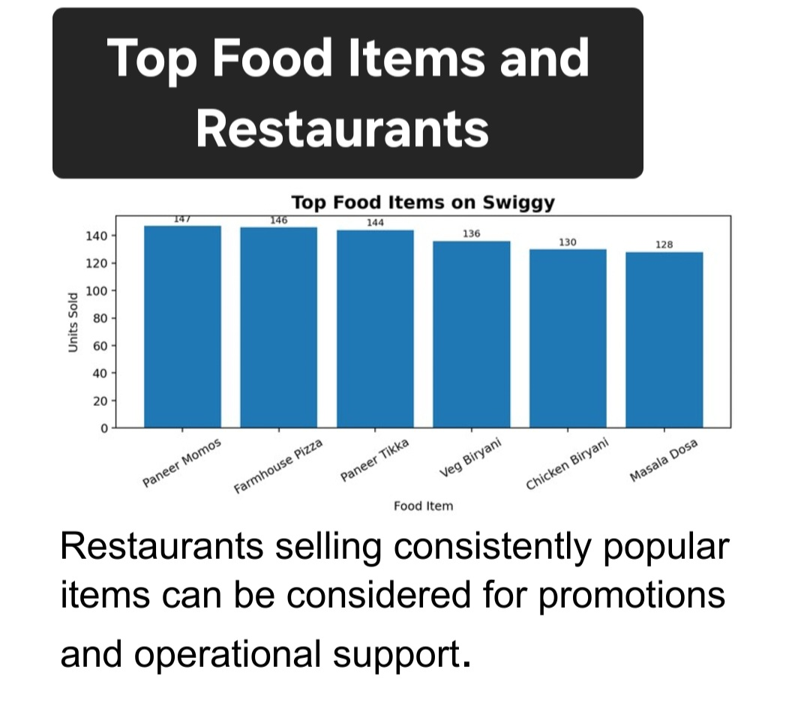
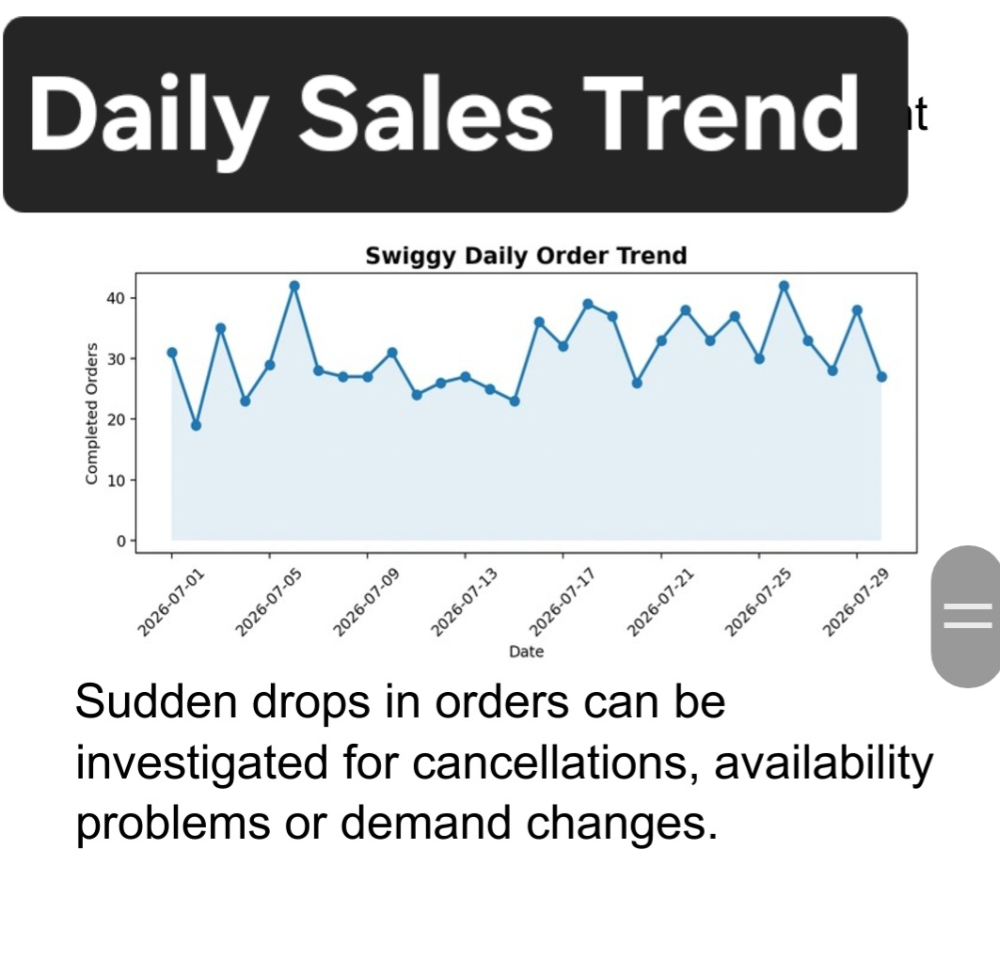
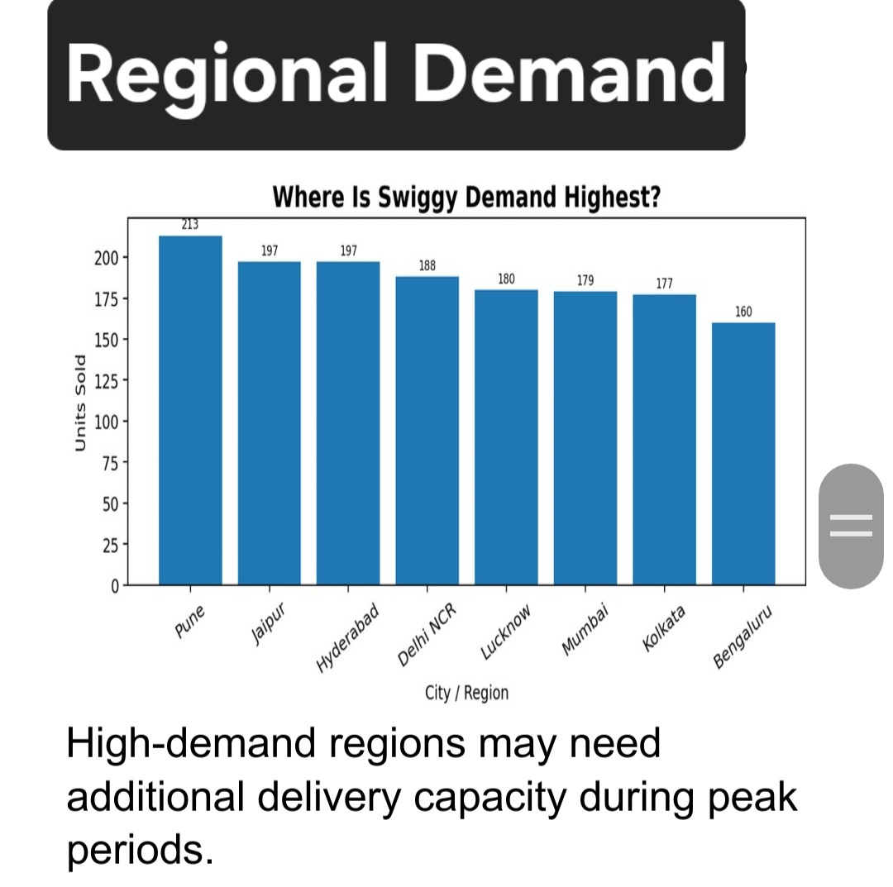
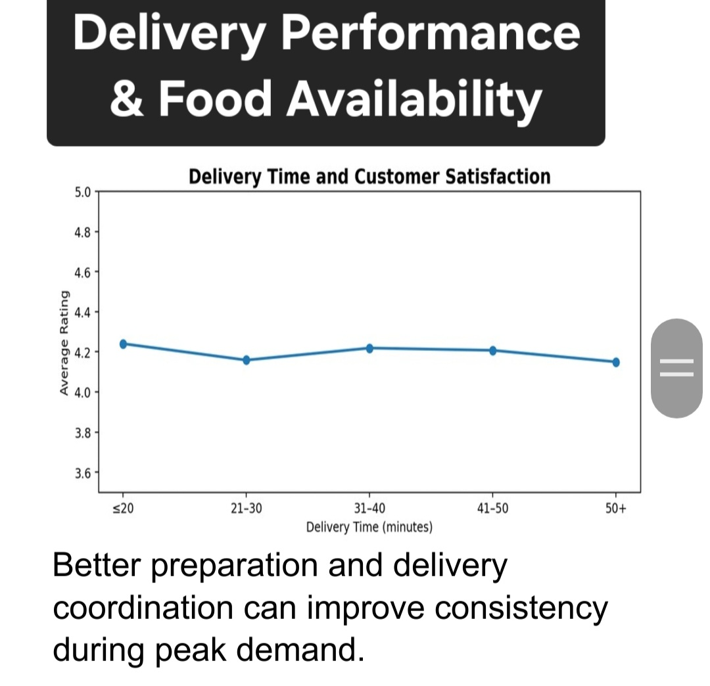
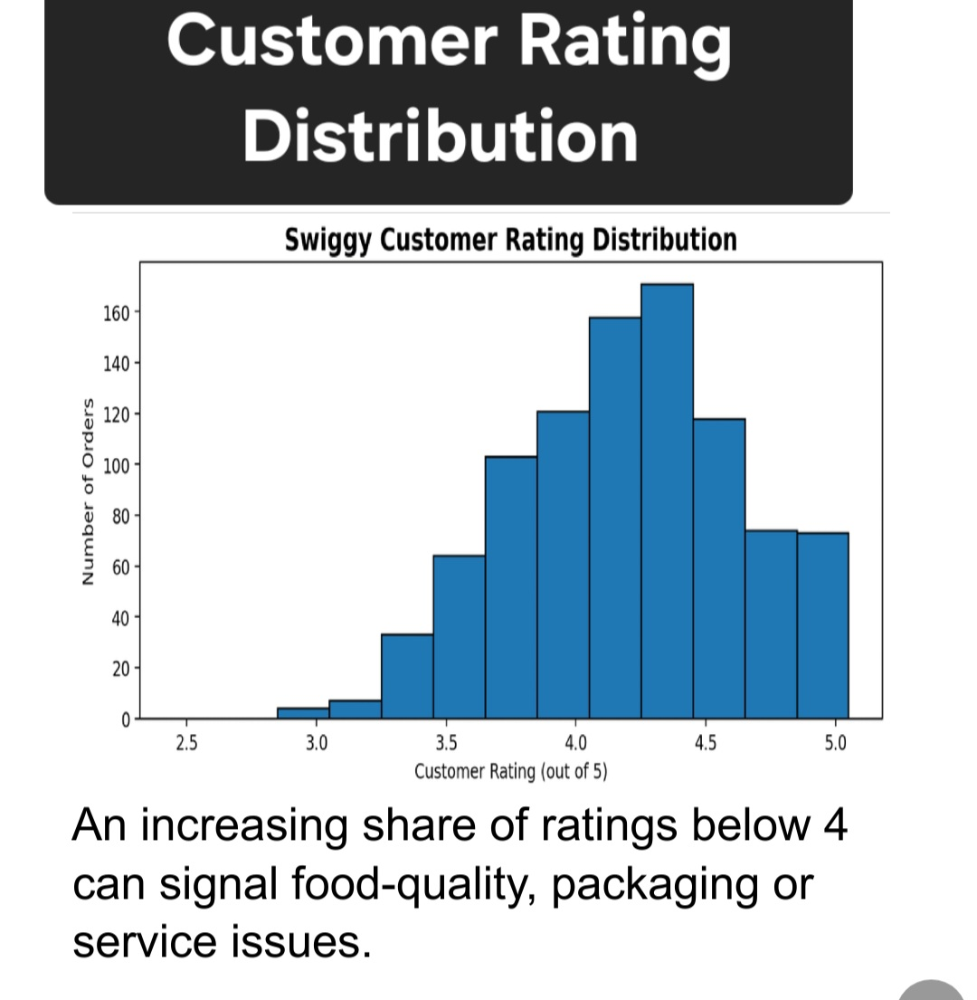

# Swiggy Descriptive Analytics Report

## Project Overview

This project analyzes Swiggy food-ordering data to understand sales, customer ratings, regional demand, and delivery performance.

**Note:** The project uses a synthetic dataset for academic purposes.

## Objectives

- Identify best-selling food items.
- Analyze sales and order trends.
- Study customer ratings.
- Compare regional demand.
- Evaluate delivery performance and food availability.

## Tools and Technologies

Python, SQL, Microsoft Excel, and Tableau.

## Key Findings

- Top food item: Paneer Momos
- Highest-demand city: Pune
- Average delivery time: 32.2 minutes
- Average rating: 4.20/5
- Average daily orders: Approximately 31

## Graphical Analysis

### Top Food Items and Restaurants

### Daily Sales Trend

### Regional Demand

### Delivery Performance and Food Availability

### Customer Rating Distribution

## Future Scope

Demand forecasting, delivery-time prediction, inventory planning, and anomaly detection.

## Conclusion

Descriptive analytics helps understand customer behaviour, improve delivery management, and support better business decisions.

**Author:** Tanushree Srivastava
